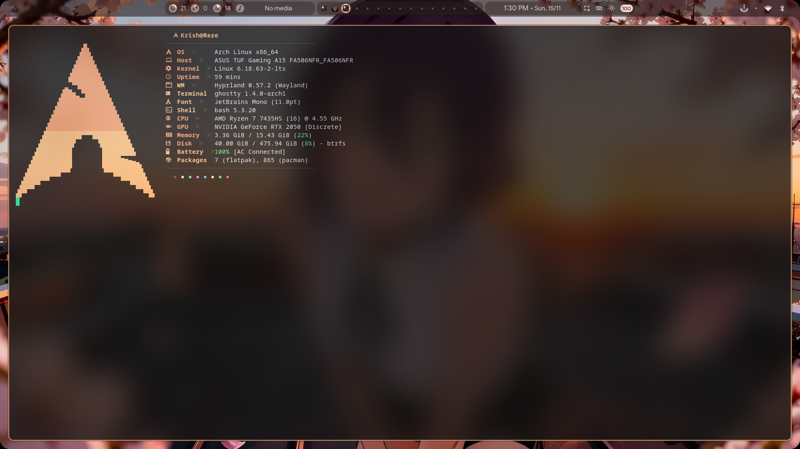
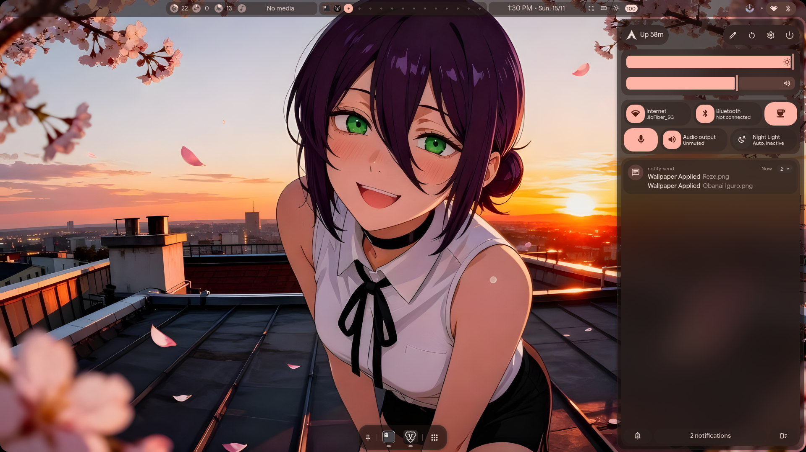
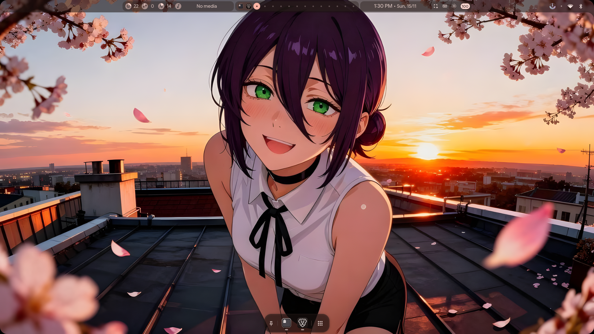
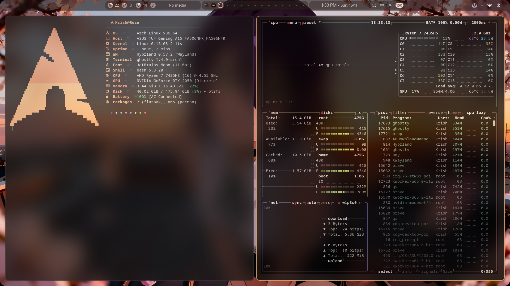
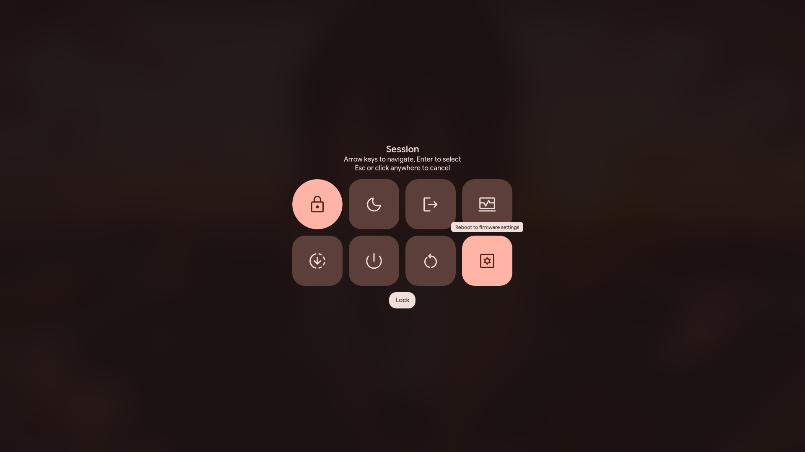

<div align="center">

# DotFiles

### Arch Linux · Hyprland · Quickshell · Material You

A reproducible, fully-integrated Wayland desktop environment built on Arch Linux. Featuring the Dotfiles Quickshell shell (a fork of upstream dots-hyprland, GPL-3.0) with a Lua-configured Hyprland compositor, automated Material You dynamic color scheme generation from wallpapers, and custom helper daemons.

<p align="center">
  
  
  
  
  
</p>

</div>

---

<div align="center">
    <h2>• Showcase •</h2>
</div>

| Terminal & Fastfetch | Widgets & Right Sidebar |
| :---: | :---: |
|  |  |
| Clean Desktop & Bar | Window Management & Monitoring |
|  |  |

<details>
  <summary>More Screenshots (Session Menu)</summary>

  | Session Menu & Power Controls |
  | :---: |
  |  |

</details>

---

## ⬡ System Architecture & Overview

This setup is built for performance, aesthetics, and deterministic reproduction across fresh Arch installations.

```
┌─────────────────────────────────────────────────────────────────────────┐
│                           HYPRLAND (LUA API)                            │
│  ┌──────────────────┐  ┌─────────────────────┐  ┌────────────────────┐  │
│  │    DOTFILES      │  │    DYNAMIC THEME    │  │   UNIVERSAL PiP    │  │
│  │  Desktop Bar     │  │   Palette Extractor │  │   Helper Daemon    │  │
│  │  Right Sidebar   │  │   Wallpaper Picker  │  │  Browser Extension │  │
│  │   OSD / Session  │  │   Matugen + Live    │  │   Floating Manager │  │
│  │  Launcher Host   │  │   Reloader          │  │                    │  │
│  └──────────────────┘  └─────────────────────┘  └────────────────────┘  │
│  ┌──────────────────┐  ┌─────────────────────┐  ┌────────────────────┐  │
│  │   APP LAUNCHER   │  │       TERMINAL      │  │    AUDIO & MEDIA   │  │
│  │ Quickshell Native│  │  Ghostty (0.20 op)  │  │ PipeWire / Player  │  │
│  │ WebApps & Plugins│  │  Nautilus / Yazi    │  │ MPRIS Mini Player  │  │
│  └──────────────────┘  └─────────────────────┘  └────────────────────┘  │
└─────────────────────────────────────────────────────────────────────────┘
```

---

## ◈ Core Components

| Layer | Component | Implementation Details |
| :--- | :--- | :--- |
| **Compositor** | Hyprland | Configured with native Lua API (`hyprland.lua`), custom gestures, blur layer rules, and hotkey bindings. |
| **Desktop Shell** | Quickshell (Dotfiles fork of upstream dots-hyprland, GPL-3.0) | QML bar with pill workspace pager, right sidebar (uptime, quick toggles, notification centre, calendar/To-Do/Timer), network and bluetooth controls, audio OSD, and session menu. |
| **Launcher** | Quickshell AppLauncher (legacy host) | Native QML full-screen application launcher with integrated webapps and plugin management, with an ii-style command palette available via `SUPER + TAB`. |
| **Theme Engine** | Material You (`config/DotFiles`) + `matugen` | Dual engine: `generate-theme.py` for Hyprland/GTK/Dunst/Ghostty, and `matugen` (with `materialyoucolor` venv) for the Dotfiles shell palette. |
| **Wallpaper Picker** | Custom 3D Carousel | OpenGL and Python wallpaper selector with instant theme regeneration and swww transitions. |
| **Notifications** | Quickshell (`ii` notification server) | Notifications are owned by the Dotfiles shell; unread badge in the bar, top-right popups. |
| **Picture-in-Picture**| Hypr-PiP | Background Python daemon + Chromium browser extension for universal floating video pin management. |
| **Terminal** | Ghostty | High-performance GPU-accelerated terminal running at 0.20 background opacity with blur. |
| **File Manager** | Nautilus + Yazi | GTK4 graphical manager (Nautilus) alongside terminal file manager (Yazi). |
| **Clipboard** | Clipse | TUI clipboard manager running with dedicated floating window rules. |
| **Display Manager** | SDDM | Custom `hyprland-sddm` theme with dynamic wallpaper autorefresh and reverse-blur focus. |
| **Bootloader** | GRUB | Minimalist `silent` theme with dynamic wallpaper integration. |

---

## ⚡ Keybindings Cheat Sheet

The default modifier key is `SUPER` (`Mod4`).

### ◇ Window Management

| Shortcut | Action |
| :--- | :--- |
| `SUPER + Q` | Close active window |
| `SUPER + V` | Toggle floating mode |
| `SUPER + F` | Toggle fullscreen |
| `SUPER + P` | Toggle pseudo-tiling mode |
| `SUPER + J` | Toggle split direction |
| `SUPER + H / J / K / L` | Move focus in direction |
| `SUPER + 1 - 9` | Switch to workspace 1 to 9 |
| `SUPER + SHIFT + 1 - 9` | Move active window to workspace 1 to 9 |
| `SUPER + MOUSE_LEFT` | Move window interactively |
| `SUPER + MOUSE_RIGHT` | Resize window interactively |

### ◇ System & Shell Launchers

| Shortcut | Action |
| :--- | :--- |
| `SUPER + RETURN` | Launch Ghostty terminal |
| `SUPER + SPACE` | Toggle Quickshell application launcher |
| `SUPER + C` / `SUPER + N` | Toggle Dotfiles right sidebar |
| `SUPER + SHIFT + N` | Close Dotfiles right sidebar |
| `SUPER + TAB` | Toggle Dotfiles overview/search palette |
| `SUPER + E` | Open Nautilus file manager |
| `SUPER + B` | Launch default browser |
| `SUPER + ESCAPE` | Toggle Dotfiles session & power menu |
| `SUPER + V` (Clipboard) | Open Clipse clipboard history |
| `SUPER + SHIFT + S` | Interactive area screenshot (slurp + grim) |
| `SUPER + W` | Open 3D wallpaper carousel picker |

### ◇ Media & Hardware Keys

| Key | Action |
| :--- | :--- |
| `XF86AudioRaiseVolume` | Volume +5% (Triggers Dotfiles OSD) |
| `XF86AudioLowerVolume` | Volume -5% (Triggers Dotfiles OSD) |
| `XF86AudioMute` | Toggle audio mute |
| `XF86MonBrightnessUp` / `F8` | Brightness +5% (Triggers Dotfiles OSD) |
| `XF86MonBrightnessDown` / `F7` | Brightness -5% (Triggers Dotfiles OSD) |
| `XF86AudioPlay` / `Pause` | Play / Pause active MPRIS player |
| `XF86AudioNext` / `Prev` | Next / Previous track |

---

## ⚙ Installation & Deployment

### Prerequisites

- A fresh or existing installation of **Arch Linux**.
- An active internet connection.
- A standard non-root user with `sudo` privileges.

### 1. Clone the Repository

```bash
git clone https://github.com/krreeshhh/DotFiles.git ~/Dotfiles
cd ~/Dotfiles
```

### 2. Run the Installer

The installer automatically detects hardware (including NVIDIA GPUs), configures pacman/AUR packages, sets up systemd user units, deploys config trees, installs SDDM and GRUB themes, and initializes the dynamic theme engine.

```bash
# Standard Core Installation (Hyprland + Quickshell + Drivers + UI)
./install.sh --core

# Full Desktop Installation (Core + All Browsers + Media Apps + Dev Tools)
./install.sh --all

# Deploy Config Files Only (Skip package installations)
./install.sh --config-only
```

You can also run `./install.sh` without flags for an interactive CLI menu.

---

## ⟡ Repository File Structure

```text
DotFiles/
├── assets/
│   ├── fonts/               # Custom system fonts (The Last Shuriken, Torus)
│   ├── hypr-pip/            # Chromium extension for Universal Picture-in-Picture
│   ├── share/               # Desktop launcher entries (.desktop) and webapp icons
│   ├── themes/
│   │   └── grub/silent/     # Active minimalist GRUB bootloader theme
│   └── wallpapers/          # Packaged aesthetic wallpaper collection (27 wallpapers)
├── bin/                     # Standalone custom binaries (hypr-pip-helper, clipse)
├── config/
│   ├── clipse/              # Clipboard manager config
│   ├── dunst/               # Notification styling
│   ├── environment.d/       # Session environment variables
│   ├── ghostty/             # Ghostty terminal config
│   ├── gtk-3.0/ & gtk-4.0/  # GTK interface themes and icons
│   ├── hypr/                # Hyprland configuration (hyprland.lua, pip.lua, scripts)
│   ├── DotFiles/          # Material You theme extractor, DOTFILES-INSTALL.md, wallpaper engines
│   ├── matugen/             # Matugen templates & config (Dotfiles shell palette)
│   ├── dotfiles/            # Dotfiles shell config (Material You palette, toggles, transparency)
│   ├── quickshell/          # Launcher/auth host + Dotfiles fork of upstream dots-hyprland (GPL-3.0)
│   ├── systemd/user/        # Systemd user services (hypr-pip, quickshell, battery-alert)
│   └── yazi/                # Terminal file manager configuration
├── packages/                # Explicit package manifests (pacman, AUR, fonts)
├── scripts/                 # System verify test runner and maintenance utilities
├── system/                  # System-level configuration (/etc/sddm.conf.d, etc.)
├── install.sh               # Automated deployment script
├── MANIFEST.md              # Complete catalog of all tracked files
├── REPRODUCTION.md          # Step-by-step fresh install guide
└── INSTALL-ORDER.md         # Deterministic dependency execution order
```

---

## ✦ Verification & Integrity Testing

To verify the integrity of the repository configuration, syntax, and asset trees at any time:

```bash
./scripts/verify.sh
```

This runs a test suite (72 automated checks) covering:
- Directory structures and documentation manifests.
- Pacman and AUR package manifest integrity.
- Hyprland daemon scripts and hotkey bindings.
- Quickshell modular QML plugin trees.
- Shell script syntax verification (`bash -n`) on all `.sh` scripts.
- Python compilation checks (`py_compile`) on all `.py` scripts.
- SDDM and GRUB active theme configurations.
- Wallpaper and font bundle integrity.

---

## License

This configuration is released under the [MIT License](LICENSE), except the vendored Dotfiles shell tree under `config/quickshell/dotfiles/`, which is GPL-3.0 and is based on [`end-4/dots-hyprland`](https://github.com/end-4/dots-hyprland) (see `NOTICE.md` and `LICENSE-GPL-3.0` inside that tree).
