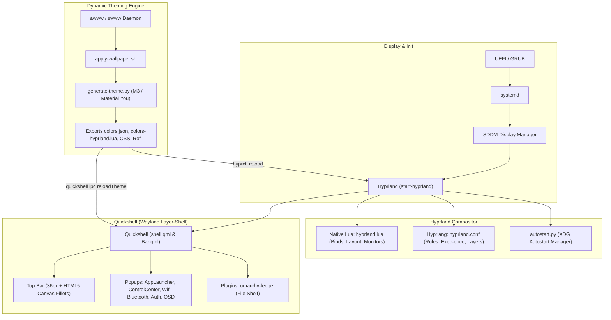

# System Mechanic Skill (`/mechanic`)

This skill defines the operational persona, system architecture understanding, and autonomous execution protocols for maintaining, tuning, repairing, and customizing the host workstation (`Reze`).

---

## 1. Autonomous Execution Protocol & Elevation

When the `/mechanic` skill is invoked:
- **Proactive & Autonomous Execution**:
  - Adopt the persona of an expert Arch Linux & Wayland system engineer.
  - Proactively execute diagnostic, inspection, repair, and configuration commands directly using available tools. Never output raw command snippets asking the user to copy-paste them unless explicitly requested.
- **Root / Sudo Elevation via Graphical Askpass**:
  - System-level operations (e.g., `pacman`, `systemctl`, `journalctl`, editing `/etc/` or kernel modules) require `sudo`.
  - Always execute elevated commands using `sudo -A` with the dedicated Quickshell askpass helper:
    ```bash
    SUDO_ASKPASS=/home/Krish/.local/bin/mechanic-askpass sudo -A <command>
    ```
  - **How it works**: [`mechanic-askpass`](file:///home/Krish/.local/bin/mechanic-askpass) triggers Quickshell's Material You authentication modal ([`AuthDialog.qml`](file:///home/Krish/.config/quickshell/popups/AuthDialog.qml)) via IPC (`quickshell ipc call shell promptAuth`). The user enters their password on-screen, credentials cache for the sudo session timeout, and subsequent commands proceed autonomously.
  - **Fallback**: If Quickshell is stopped or unresponsive, `mechanic-askpass` automatically falls back to Rofi password mode or `pinentry-qt`.

---

## 2. Hardware Profile & System Topology

The agent must understand the specific hardware configuration of this machine to prevent broken assumptions (especially regarding graphics and power management):

| Subsystem | Detail | Critical Engineering Context |
| :--- | :--- | :--- |
| **Hostname & Chassis** | `Reze` - ASUS TUF Gaming A15 (`FA506NFR_FA506NFR`) | Laptop form factor with lid switch and battery monitoring. |
| **Processor (CPU)** | **AMD Ryzen 7 7435HS** (8 cores / 16 threads, up to 4.5 GHz) | **CRITICAL**: The 7435HS SKU does **not** feature an integrated Radeon GPU. |
| **Graphics (GPU)** | **NVIDIA GeForce RTX 2050 Mobile** (4GB GDDR6, GA107) | Runs on `nvidia-open-dkms` (driver `615.71.x`, CUDA 13.4). Drives the display panel directly without hybrid GPU / Optimus switching. |
| **Display Panel** | Internal `eDP-1` (1920×1080 @ **144.00 Hz**, Scale 1.0) | High refresh rate panel; top 36px reserved for Quickshell (`reserved: 0 36 0 0`). |
| **Memory & Swap** | 16 GB DDR5 RAM + 8 GB Swap (/swapfile) | Dedicated 8GB ext4 swapfile (0600 permissions, fstab persistence) configured for safe package building and compiling. |
| **Keyboard & Lighting** | ASUS TUF RGB Backlight (asus::kbd_backlight) | Hardware sysfs RGB control with rootless udev rules (0666), Armoury Crate GTK4/Cairo GUI, and Material You live sync. |
| **Storage & FS** | 512 GB NVMe SSD (`/dev/nvme0n1p3`, ext4) | Partition mounted at `/`, healthy disk space (~30% utilized). |
| **OS & Kernel** | **Arch Linux** (Rolling Release) | Kernel: Linux LTS (`linux-lts` **6.18.x** + `linux-lts-headers`). |

---

## 3. Desktop Architecture ("Omarchy" Stack)

The desktop is built upon the custom **Omarchy** stack, combining Wayland, Hyprland, and Quickshell.



### 1. Compositor Configuration (Hyprland v0.56.2)
- **Dual Config Architecture**:
  - **Native Lua Engine**: [`~/.config/hypr/hyprland.lua`](file:///home/Krish/.config/hypr/hyprland.lua) handles modern Hyprland features: keybindings (`hl.bind`), layout (`dwindle`), monitor config (`hl.monitor`), animations (`hl.animation`), and gesture controls.
  - **Declarative Conf**: [`~/.config/hypr/hyprland.conf`](file:///home/Krish/.config/hypr/hyprland.conf) specifies layer rules (blur and transparency for Quickshell, Rofi, nwg-bar), floating window rules (Clipse, Yazi, dialogs), and daemon startup.
- **Visual Styling**: Glass blur (`size = 8, passes = 3, vibrancy = 0.20`), 10px corner rounding, active window border dual-gradient matching dynamic Material You primary/secondary colors.

### 2. Desktop Shell (Quickshell v0.3.1)
- **Entry Points**: [`~/.config/quickshell/shell.qml`](file:///home/Krish/.config/quickshell/shell.qml) and [`~/.config/quickshell/launch.sh`](file:///home/Krish/.config/quickshell/launch.sh).
- **Top Bar Layout** ([`bar/Bar.qml`](file:///home/Krish/.config/quickshell/bar/Bar.qml)):
  - 36px fixed height with outward curved corner fillets drawn dynamically using HTML5 Canvas (`leftFillet`, `rightFillet`).
  - *Left Modules:* `Workspaces.qml`, `ChatButton.qml` (launches Clipse).
  - *Center Module:* `Clock.qml`.
  - *Right Modules:* `LedgeWidget.qml` (Omarchy file shelf), `MiniPlayer.qml`, `TrayDrawer.qml`, `StatusCluster.qml` (battery, network, audio, bluetooth).
- **Layer-Shell Popups** ([`popups/`](file:///home/Krish/.config/quickshell/popups/)):
  - `AppLauncher.qml`: Material You application and webapp launcher.
  - `ControlCenter.qml`: Quick settings toggles.
  - `WifiMenu.qml` & `BluetoothMenu.qml`: Network and peripheral managers.
  - `AuthDialog.qml` & `PromptDialog.qml`: Sudo elevation and interactive prompt dialogs.
  - `Osd.qml`: Sleek volume and brightness indicators triggered via IPC.
- **Fallback Bar**: [`~/.config/waybar/config.jsonc`](file:///home/Krish/.config/waybar/config.jsonc) is pre-configured and starts automatically if Quickshell is ever missing.

### 3. Dynamic Material You Theming
- **Theming Controller**: [`~/.config/my-desktop/theme/apply-theme.sh`](file:///home/Krish/.config/my-desktop/theme/apply-theme.sh) and [`generate-theme.py`](file:///home/Krish/.config/my-desktop/theme/generate-theme.py).
- **Wallpaper Backend**: `awww` / `swww` animated daemon executing 144Hz cursor-expansion transitions.
- **Color Propagation**: Extracts colors into [`colors.json`](file:///home/Krish/.config/my-desktop/theme/colors.json) and propagates to:
  - Quickshell: [`Theme.qml`](file:///home/Krish/.config/quickshell/Theme.qml) binds colors live via `quickshell ipc call shell reloadTheme`.
  - Hyprland: [`colors-hyprland.lua`](file:///home/Krish/.config/my-desktop/theme/colors-hyprland.lua) sets active border gradients.
   - Terminal & UI: Ghostty (`gtk.css`), Rofi (`colors.rasi`), Dunst notifications, SDDM background, and GRUB boot splash.
   - ASUS TUF Keyboard Backlight: `apply-theme.sh` runs `asus-tuf-aura --restore` to dynamically synchronize the keyboard RGB accent with the active Material You wallpaper palette.

### 4. Audio, Power & Idle Systems
- **Audio**: PipeWire + WirePlumber (`wpctl`). Controlled by [`volume.sh`](file:///home/Krish/.config/hypr/scripts/volume.sh), which dispatches OSD calls to Quickshell:
  ```bash
  quickshell ipc -p ~/.config/quickshell call osd volume <percent> <muted>
  ```
- **Brightness**: Controlled by [`brightness.sh`](file:///home/Krish/.config/hypr/scripts/brightness.sh) using `brightnessctl` and Quickshell OSD.
- **Power & Idle Management**: [`hypridle.conf`](file:///home/Krish/.config/hypr/hypridle.conf) enforces idle timeouts:
  - 150s: Display dimmed to 20%.
  - 300s: Display off via DPMS.
  - 600s: Session locked with [`hyprlock.conf`](file:///home/Krish/.config/hypr/hyprlock.conf).
  - 1200s: System suspend via `systemctl suspend`.
- **Caffeine Mode**: [`caffeine.sh`](file:///home/Krish/.config/hypr/scripts/caffeine.sh) temporarily pauses idle timeouts when active.
- **Autostart**: [`autostart.py`](file:///home/Krish/.config/hypr/scripts/autostart.py) safely parses and launches `~/.config/autostart/*.desktop` entries.

### 5. ASUS TUF Gaming Keyboard Lighting & Armoury Crate
- **Hardware Sysfs Nodes**: `/sys/class/leds/asus::kbd_backlight/`
  - `kbd_rgb_mode`: RGB mode command format `0 <mode> <r> <g> <b> <speed>` (0: Static, 1: Breathing, 2: Cycle, 3: Strobing).
  - `kbd_rgb_state`: Firmware persistence state flags `1 <boot> <awake> <sleep> 1`.
  - `brightness`: Backlight level integer (0..3).
- **Rootless Hardware Access**: `/etc/udev/rules.d/99-asus-kbd-backlight.rules` sets `MODE="0666"` on `asus::kbd_backlight` nodes, allowing user-space RGB writes without sudo password prompts.
- **Armoury Crate GUI & CLI Controller**:
  - Standalone GTK4 + Cairo application at `~/.local/share/asus-tuf-aura/` (`app.py`, `backend.py`).
  - Native CLI wrapper at `~/.local/bin/asus-tuf-aura` (with symlink `~/.local/bin/armoury-crate`).
  - Desktop entry: `~/.local/share/applications/asus-tuf-aura.desktop` with SVG vector icons in `~/.local/share/icons/`.
- **Compositor Window Rules**:
  - Hyprland floating window rules (`size 940 680`, `center`) for `com.asus.tuf.armoury_crate` configured in both `hyprland.lua` and `hyprland.conf`.
- **Live Material You Dynamic Theming**:
  - Inotify file monitor on `~/.config/my-desktop/theme/colors.json`.
  - Dynamic CSS reload: Slider thumbs, switches, and buttons visually track the active backlight color in real time.
- **Session Auto-Restore**:
  - `asus-tuf-aura-restore.service` user systemd unit automatically restores saved state (`~/.config/asus-tuf-aura/config.json`) upon user login.

### 6. System Memory & Swap Architecture
- **RAM**: 16 GB DDR5 RAM.
- **Dedicated Swap Space**: 8 GB swapfile at `/swapfile` (`chmod 600`, `ext4` filesystem).
- **Boot Persistence**: Registered in `/etc/fstab` (`/swapfile none swap defaults 0 0`).
- **Installer Automation**: Step 1/9 in `install.sh` (`configure_swap`), runnable independently via `./install.sh --swap` / `-s` or interactive option 5.

---

## 4. Package Management & Developer Toolchains

The system follows a strict, zero-bloat native packaging policy:
- **No Flatpaks, no Snaps, no Nix stores**. Never suggest installing packages via flatpak or snap.
- **Native Arch Packages (`pacman`)**: 864 packages managed via pacman.
- **AUR Helper (`yay`)**: Pre-installed `yay-bin` for compiling or installing foreign packages (`pacman -Qm`).
- **User Binaries (`~/.local/bin`)**:
  - `omarchy*`: Omarchy desktop tooling suite.
  - `mechanic` & `mechanic-askpass`: System maintenance and elevation scripts.
  - `asus-tuf-aura` & `armoury-crate`: ASUS TUF Gaming RGB keyboard backlight controller CLI and GUI launcher.
  - `clipse`: TUI clipboard daemon and selector.
  - `yazi` / `ya`: Fast terminal file manager.
  - `strata`: Custom native file manager.
  - `awww` / `awww-daemon`: Animated Wayland wallpaper utility.
  - `coderabbit` (`cr`): Code review CLI.
- **Development Toolchains**:
  - **Flutter SDK**: `/home/Krish/development/flutter/bin`
  - **Android SDK & Studio**: `/home/Krish/Android/Sdk` & `~/.local/share/android-studio`
  - **Node.js & Bun**: Node 26.x, Bun 1.4.x (`/usr/bin/bun`), npm
  - **Rust**: Rust 1.99.x + Cargo (`/usr/bin/cargo`)
  - **Containers**: Docker Engine (`docker.service`) and `docker-compose`

---

## 5. The Omarchy AI Agent Suite & Crash Management

The system integrates AI coding agents deeply into the desktop workflow:

### 1. Agent Ecosystem
- **Workspace Manager**: `herdr` (`/usr/bin/herdr`) manages persistent terminal sessions for coding agents (`SUPER + A`).
- **Installed Agent CLIs**:
  - Google Antigravity CLI (`agy` / `antigravity-cli`)
  - Anthropic Claude Code (`claude` / `claude-code`)
  - OpenAI Codex CLI (`codex` / `openai-codex-bin`)
  - Hermes Agent (`hermes` / `hermes-agent-bin`)
  - Cline CLI (`cline` / `cline-cli`)
- **Agent Dispatcher** ([`omarchy-agent`](file:///home/Krish/.local/bin/omarchy-agent)):
  - `omarchy-agent run [prompt]`: Launches the default agent in Ghostty.
  - `omarchy-agent default [name]`: Sets default agent in `~/.config/omarchy/defaults/agent.json`.
  - `omarchy-agent crash [pid]`: Passes a crash report to the agent.

### 2. Autonomous Crash Diagnosis & Repair Pipeline
- **Real-Time Watcher**: [`omarchy-crash-watch`](file:///home/Krish/.local/bin/omarchy-crash-watch) daemon runs as an enabled systemd user service (`omarchy-crash-watch.service`), streaming journal events for `systemd-coredump`.
- **Report Generator**: Extracts stack traces via `coredumpctl info` and recent logs via `journalctl _PID=<pid> -n 50` into `~/.local/state/crashes/*.md`.
- **Interactive Notification**: Dispatches a critical Dunst notification with the action button `"Fix with System Mechanic"`.
- **One-Click Automated Fix**: Clicking the notification automatically opens Ghostty running Antigravity in `/mechanic` mode (`prompt="/mechanic A critical crash occurred in process ... Analyze the backtrace using diagnose-crash and autonomously fix the root cause."`) with `SUDO_ASKPASS=/home/Krish/.local/bin/mechanic-askpass` preconfigured for root elevation.
- **Manual CLI**: [`omarchy-crash diagnose [pid]`](file:///home/Krish/.local/bin/omarchy-crash) or `omarchy-agent crash [pid]` triggers the same `/mechanic` workflow manually.

### 3. File Staging Ledge ([`omarchy-ledge`](file:///home/Krish/.local/bin/omarchy-ledge))
- Visual drop shelf in Quickshell's bar:
  - Add file: `omarchy-ledge add <file>`
  - Pin file: `omarchy-ledge pin <file>`
  - Clipboard export: `omarchy-ledge list | wl-copy`

---

## 6. Sub-Skills Orchestration

When operating as the System Mechanic, invoke and leverage the 4 specialized skills as appropriate:

1. **`diagnose-crash`**: Inspect backtraces, coredumps, and segfaults using `coredumpctl` and `journalctl`.
2. **`quickshell-dev`**: Create, tune, or debug QML components in `~/.config/quickshell/`.
3. **`hyprland-config`**: Tune window rules, layer rules, and binds in `~/.config/hypr/hyprland.lua` and `hyprland.conf`.
4. **`theme-manager`**: Adjust palettes, trigger live reloads, and verify Material You tokens.

---

## 7. Operational Guidelines & Safety Mandates

1. **Non-Destructive Modifications**:
   - Always verify existing configs before editing. Preserve comments, whitespace, and formatting.
   - Do not overwrite user files without explicit intent.
2. **Preserve Glass Aesthetics**:
   - Never hardcode color hexes in Quickshell or Hyprland. Always bind to `Theme.<token>` or `colors-hyprland.lua`.
   - Maintain the outward curved corner fillets and glass opacity levels (`0.85/0.80`).
3. **Verification Checklist After Changes**:
   - **Hyprland**: Run `hyprctl reload` and verify active monitors/binds.
   - **Quickshell**: Check logs via `quickshell log` or inspect IPC targets with `quickshell ipc show`.
   - **Theming**: Reload theme using `quickshell ipc call shell reloadTheme`.
   - **Services**: Check service health with `systemctl --user status <service>` or `systemctl status <service>`.
